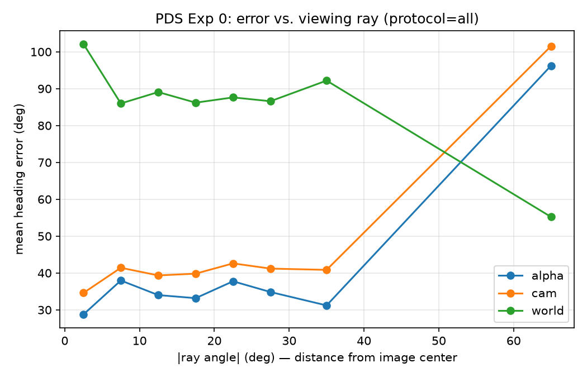

# PDS Experiment 0 — Results / 結果

Predictions: 21105 rows, folds: 5

## 1. Overall heading error / 整體朝向誤差 (deg, mean ± std across folds)

| protocol | target | mean err | median err | acc@30° | const baseline |
|---|---|---|---|---|---|
| all | alpha | 33.1 ± 4.9 | 16.6 ± 2.4 | 69.0 ± 5.9% | 84.0 |
| all | cam | 39.1 ± 5.9 | 23.1 ± 3.6 | 59.6 ± 5.9% | 84.0 |
| all | world | 90.3 ± 4.9 | 89.4 ± 6.5 | 13.8 ± 4.2% | 82.7 |
| allsub | alpha | 44.7 ± 10.4 | 27.5 ± 10.6 | 54.2 ± 14.9% | 83.5 |
| allsub | cam | 51.7 ± 7.8 | 34.8 ± 7.8 | 45.5 ± 7.6% | 83.1 |
| allsub | world | 89.0 ± 7.0 | 87.5 ± 8.2 | 16.8 ± 6.2% | 84.8 |
| front | alpha | 65.2 ± 11.0 | 45.1 ± 20.2 | 42.1 ± 13.4% | 94.0 |
| front | cam | 68.4 ± 12.5 | 52.9 ± 19.1 | 37.3 ± 14.0% | 87.7 |
| front | world | 91.3 ± 6.3 | 91.8 ± 13.5 | 13.6 ± 2.0% | 108.1 |

## 2a. Cross-camera: trained on CAM_FRONT only / 只用前相機訓練

| camera | alpha | cam | world |
|---|---|---|---|
| CAM_FRONT | 53.3 | 51.1 | 85.7 |
| CAM_FRONT_LEFT | 62.2 | 51.6 | 80.3 |
| CAM_FRONT_RIGHT | 63.4 | 62.7 | 91.7 |
| CAM_BACK | 81.0 | 94.8 | 99.4 |
| CAM_BACK_LEFT | 67.2 | 74.9 | 91.4 |
| CAM_BACK_RIGHT | 72.4 | 67.9 | 81.6 |

## 2b. Cross-camera: all cameras, same data size as front / 所有相機、與 front 同資料量

| camera | alpha | cam | world |
|---|---|---|---|
| CAM_FRONT | 44.7 | 53.0 | 98.0 |
| CAM_FRONT_LEFT | 40.8 | 43.7 | 67.5 |
| CAM_FRONT_RIGHT | 49.3 | 58.6 | 92.6 |
| CAM_BACK | 47.4 | 54.8 | 75.4 |
| CAM_BACK_LEFT | 50.3 | 56.0 | 74.8 |
| CAM_BACK_RIGHT | 44.4 | 47.4 | 95.4 |

Viewpoint effect = front − allsub (same data size). Data-size effect = allsub − all.
視角效應 = front − allsub（資料量相同）。資料量效應 = allsub − all。

## 3. Error vs. off-center angle |ray| / 誤差 vs. 偏離中心角度

| abs(ray) bin | n | alpha | cam | world |
|---|---|---|---|---|
| [0, 5) | 479 | 28.8 | 34.6 | 102.1 |
| [5, 10) | 327 | 38.0 | 41.4 | 86.0 |
| [10, 15) | 404 | 34.0 | 39.3 | 89.1 |
| [15, 20) | 451 | 33.2 | 39.8 | 86.2 |
| [20, 25) | 399 | 37.8 | 42.6 | 87.6 |
| [25, 30) | 194 | 34.8 | 41.2 | 86.6 |
| [30, 40) | 88 | 31.2 | 40.8 | 92.2 |
| [40, 90) | 3 | 96.2 | 101.5 | 55.2 |

