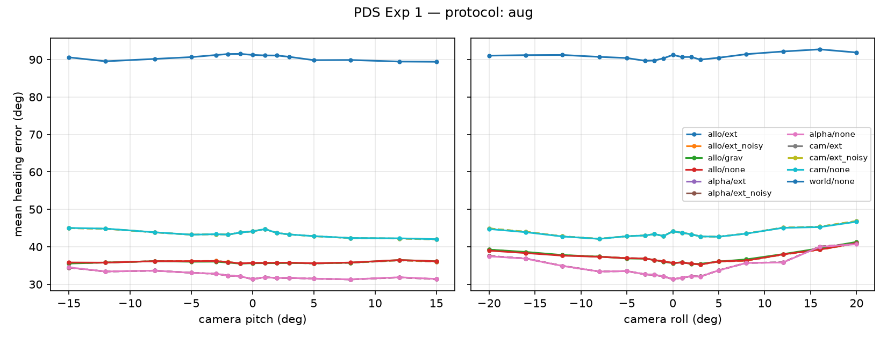
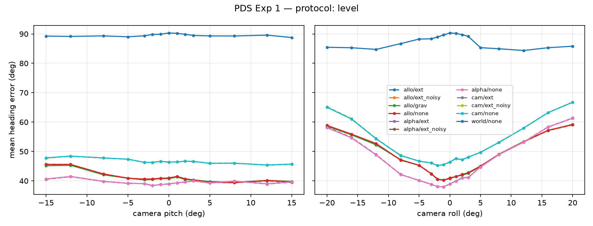

# PDS Experiment 1 — Label frame × camera tilt / 標籤座標系 × 攝影機傾斜

Folds: 5 · objects per fold avg: 362

## Protocol: aug

| method | level err (°) | pitch tolerance (°) | roll tolerance (°) | err @ max pitch | err @ max roll |
|---|---|---|---|---|---|
| allo/ext | 35.7 | 15 | 20 | 35.8 | 40.1 |
| allo/ext_noisy | 35.7 | 15 | 20 | 35.9 | 40.1 |
| allo/grav | 35.6 | 15 | 20 | 35.8 | 40.3 |
| allo/none | 35.7 | 15 | 20 | 36.0 | 40.0 |
| alpha/ext | 31.4 | 15 | 20 | 32.9 | 39.2 |
| alpha/ext_noisy | 31.4 | 15 | 20 | 32.9 | 39.2 |
| alpha/none | 31.4 | 15 | 20 | 33.0 | 39.1 |
| cam/ext | 44.1 | 15 | 20 | 43.5 | 45.9 |
| cam/ext_noisy | 44.1 | 15 | 20 | 43.5 | 45.9 |
| cam/none | 44.1 | 15 | 20 | 43.5 | 45.7 |
| world/none | 91.2 | 15 | 20 | 90.0 | 91.5 |

## Protocol: level

| method | level err (°) | pitch tolerance (°) | roll tolerance (°) | err @ max pitch | err @ max roll |
|---|---|---|---|---|---|
| allo/ext | 41.0 | 15 | 20 | 42.6 | 58.8 |
| allo/ext_noisy | 41.0 | 15 | 20 | 42.6 | 58.8 |
| allo/grav | 40.7 | 15 | 20 | 42.5 | 58.9 |
| allo/none | 41.0 | 15 | 20 | 42.6 | 59.0 |
| alpha/ext | 39.0 | 15 | 16 | 40.1 | 59.8 |
| alpha/ext_noisy | 39.0 | 15 | 16 | 40.1 | 59.8 |
| alpha/none | 39.0 | 15 | 16 | 40.2 | 59.7 |
| cam/ext | 46.4 | 15 | 20 | 46.7 | 66.0 |
| cam/ext_noisy | 46.4 | 15 | 20 | 46.7 | 66.0 |
| cam/none | 46.4 | 15 | 20 | 46.8 | 65.9 |
| world/none | 90.3 | 15 | 20 | 89.0 | 85.6 |

Tolerance = largest |tilt| at which mean error stays within 1.5× the level error on both sides.
容忍度 = 兩側平均誤差都維持在水平誤差 1.5 倍以內的最大傾斜角。

`ext` decoders use known extrinsics (upper bound, RQ3); `none`/`grav` do not.
`ext` 解碼器使用已知外參（上限，RQ3）；`none`／`grav` 不使用外參。