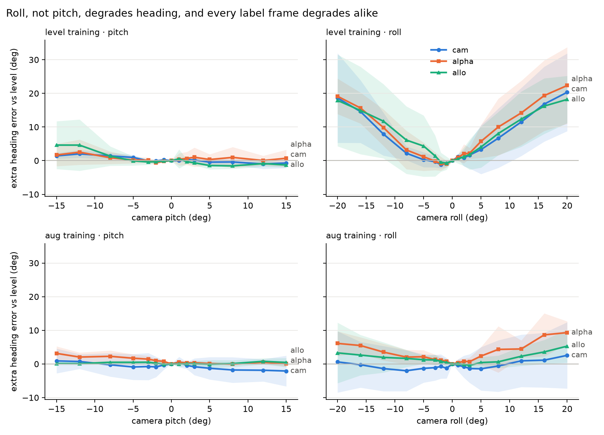

# PDS Experiment 1 — Label frame × camera tilt / 標籤座標系 × 攝影機傾斜 (backbone: resnet18)

5 folds · 1814 objects · every number below is PAIRED: error at tilt minus the same objects' error with a level camera, mean ± std over folds.
共 5 折、1814 個物體。下表皆為配對差：傾斜下誤差減去同一批物體在水平相機下的誤差（各折平均 ± 標準差）。

## 1. Degradation under tilt, extrinsics unknown / 傾斜造成的退化（外參未知）

| protocol | frame | level err (°) | pitch ±5 | pitch ±15 | roll ±5 | roll ±12 | roll ±20 |
|---|---|---|---|---|---|---|---|
| level | world | 90.3 ± 8.9 | -1.1 ± 1.0 | -1.3 ± 1.2 | -3.5 ± 2.8 | -5.8 ± 5.9 | -4.7 ± 9.3 |
| level | cam | 46.4 ± 3.2 | +0.3 ± 0.6 | +0.4 ± 0.7 | +1.8 ± 3.6 | +9.7 ± 7.6 | +19.5 ± 10.1 |
| level | alpha | 39.0 ± 4.8 | +0.3 ± 1.2 | +1.2 ± 2.8 | +3.5 ± 4.1 | +12.0 ± 7.1 | +20.7 ± 7.6 |
| level | allo | 41.0 ± 9.5 | -0.8 ± 0.9 | +1.7 ± 3.5 | +4.2 ± 3.7 | +12.0 ± 4.6 | +18.1 ± 5.1 |
| aug | world | 91.2 ± 9.8 | -1.0 ± 2.1 | -1.2 ± 1.8 | -0.8 ± 1.0 | +0.5 ± 2.1 | +0.2 ± 3.0 |
| aug | cam | 44.1 ± 3.6 | -1.1 ± 3.5 | -0.6 ± 3.9 | -1.4 ± 5.1 | -0.2 ± 6.6 | +1.6 ± 8.7 |
| aug | alpha | 31.4 ± 6.0 | +0.9 ± 0.5 | +1.6 ± 1.2 | +2.2 ± 1.4 | +4.0 ± 1.2 | +7.7 ± 2.7 |
| aug | allo | 35.7 ± 8.1 | +0.2 ± 0.6 | +0.3 ± 0.8 | +0.8 ± 0.7 | +2.1 ± 3.2 | +4.3 ± 6.4 |

`world` is at chance (~90°) everywhere, so its deltas carry no information.
`world` 在所有條件下都接近隨機（約 90°），其差值不具資訊量。

## 2. Does the frame change roll robustness? / 座標系是否改變側傾穩健性？

Per-fold difference in roll ±20° degradation (negative = first frame more robust).
各折在側傾 ±20° 下退化量的差（負值代表前者較穩健）。

The last column is the smallest mean difference a 5-fold paired t-test could detect (80% power, α = 0.05).
最後一欄是 5 折配對 t 檢定能偵測的最小平均差（檢定力 80%、α = 0.05）。

| protocol | comparison | per fold | mean ± std | folds favouring first | detectable difference |
|---|---|---|---|---|---|
| level | alpha − cam | -11.4, +17.6, +5.1, -4.2, -0.9 | +1.3 ± 10.9 | 3/5 | ±18.1° |
| level | allo − alpha | +1.1, -0.5, -13.2, -1.4, +0.6 | -2.7 ± 5.9 | 3/5 | ±9.9° |
| level | allo − cam | -10.3, +17.1, -8.1, -5.6, -0.3 | -1.4 ± 11.0 | 4/5 | ±18.3° |
| aug | alpha − cam | +2.9, +18.6, +1.6, +6.7, +0.9 | +6.1 ± 7.3 | 0/5 | ±12.1° |
| aug | allo − alpha | +0.0, -9.1, +0.3, -7.9, -0.5 | -3.4 ± 4.6 | 3/5 | ±7.7° |
| aug | allo − cam | +2.9, +9.5, +1.9, -1.2, +0.4 | +2.7 ± 4.1 | 1/5 | ±6.8° |

## 3. Does knowing the extrinsics help? / 已知外參是否有幫助？

Roll ±20° degradation by decoder. / 各解碼方式在側傾 ±20° 的退化量。

| protocol | frame | none | grav | ext | ext_noisy |
|---|---|---|---|---|---|
| level | cam | +19.5 ± 10.1 | — | +19.6 ± 9.9 | +19.6 ± 9.9 |
| level | alpha | +20.7 ± 7.6 | — | +20.8 ± 7.6 | +20.8 ± 7.7 |
| level | allo | +18.1 ± 5.1 | +18.2 ± 5.4 | +17.9 ± 5.3 | +17.9 ± 5.3 |
| aug | cam | +1.6 ± 8.7 | — | +1.8 ± 8.6 | +1.8 ± 8.6 |
| aug | alpha | +7.7 ± 2.7 | — | +7.8 ± 2.6 | +7.8 ± 2.6 |
| aug | allo | +4.3 ± 6.4 | +4.7 ± 6.1 | +4.4 ± 6.3 | +4.4 ± 6.3 |

## 4. Degradation curves / 退化曲線

Lines: mean over folds; bands: ±1 std over folds; decoder = none.
線：各折平均；色帶：各折 ±1 標準差；解碼方式 = none。

## 5. A1 mechanism check: rotate rolled crops back upright / 機制檢驗：把側傾裁切轉回直立

Level-trained models. `derot` rotates each crop by the TRUE roll before inference (oracle).
水平訓練的模型。`derot` 在推論前依真實側傾把裁切轉回（神諭）。

| frame | level err (°) | roll ±12 plain | roll ±12 derot | roll ±20 plain | roll ±20 derot |
|---|---|---|---|---|---|
| cam | 42.0 | +10.7 ± 5.3 | -0.2 ± 4.2 | +20.5 ± 4.9 | +1.2 ± 7.1 |
| alpha | 36.5 | +8.6 ± 2.7 | +2.0 ± 3.4 | +19.2 ± 5.7 | +3.1 ± 5.1 |
| allo | 42.9 | +11.4 ± 7.2 | +1.0 ± 5.2 | +19.0 ± 6.6 | +0.5 ± 7.2 |

Numbers are extra error vs the same objects with a level camera. A `derot` value near 0 means in-plane rotation explains the roll damage. Rotated crops gain black corners, a small extra handicap.
數值為與同一批物體水平相機相比多出的誤差。`derot` 接近 0 代表影像平面內旋轉可解釋側傾損害。轉正後的裁切角落會出現黑邊，是一個小額外不利因素。

## 5c. C1 de-rotation with an ESTIMATED roll (GeoCalib) / 以估計的側傾轉正（GeoCalib）

Roll is estimated from the tilted full image by GeoCalib (Veicht et al., ECCV 2024), an off-the-shelf single-image calibration model not trained on this data; crops are rotated by the estimate, mirrored corners. Level crops are also rotated by their own estimate.
側傾由 GeoCalib（ECCV 2024，現成、未以本資料訓練）從傾斜後的整張影像估計；裁切依估計值旋轉，鏡射角落。水平裁切也依其自身估計值旋轉。

Roll estimate error at roll ±20°: median 1.07°, mean 1.31°, 95th percentile 3.18° (3628 crops).
側傾 ±20° 的估計誤差：中位數 1.07°、平均 1.31°、第 95 百分位 3.18°（3628 張裁切）。

| frame | roll ±20 plain | true roll (oracle) | estimated roll | level cost of the correction | folds where estimated beats plain |
|---|---|---|---|---|---|
| cam | +20.5 ± 4.9 | +0.6 ± 3.7 | +0.2 ± 3.5 | -1.0 ± 1.1 | 5/5 |
| alpha | +19.2 ± 5.7 | +1.0 ± 0.9 | +1.3 ± 1.3 | -0.6 ± 1.0 | 5/5 |
| allo | +19.0 ± 6.6 | +0.9 ± 2.6 | +1.1 ± 2.3 | -0.1 ± 1.4 | 5/5 |

Extra error vs the same objects with a level camera and no rotation (mean ± std over folds).
相對同一批物體、水平相機、不旋轉時多出的誤差（各折平均 ± 標準差）。

## 5b. A1c corner-fill check: black vs mirrored corners / 角落填補檢驗：黑邊 vs 鏡射

Same models and crops as section 5. Rotating a square crop by 20° leaves ~12% of its pixels uncovered; `black` fills them with black (as in section 5), `reflect` with mirrored image content. A real system would de-rotate the whole frame, where such corners do not appear around the object.
與第 5 節相同的模型與裁切。正方形裁切旋轉 20° 會露出約 12% 的像素；`black` 以黑色填補（同第 5 節），`reflect` 以鏡射影像內容填補。實際系統會轉正整張影像，物體周圍不會出現這種角落。

| frame | roll ±20 plain | derot black | derot reflect | per fold, black | per fold, reflect | folds where reflect is closer to level |
|---|---|---|---|---|---|---|
| cam | +20.5 ± 4.9 | +1.2 ± 7.1 | +0.6 ± 3.7 | +3.4, -7.2, +4.4, -4.6, +10.2 | +0.7, -5.5, +3.9, +0.9, +3.0 | 5/5 |
| alpha | +19.2 ± 5.7 | +3.1 ± 5.1 | +1.0 ± 0.9 | +1.8, -3.9, +5.2, +2.2, +10.2 | +0.8, +0.9, +0.1, +2.5, +0.9 | 4/5 |
| allo | +19.0 ± 6.6 | +0.5 ± 7.2 | +0.9 ± 2.6 | -0.4, +4.3, -9.3, -1.9, +9.9 | +1.3, -0.9, +0.1, -1.1, +5.2 | 4/5 |

Extra error at roll ±20° vs the same objects with a level camera (mean ± std over folds).
側傾 ±20° 相對同一批物體水平相機多出的誤差（各折平均 ± 標準差）。

## 6. A1b de-rotation with a noisy roll estimate, black corners / 以含誤差的側傾估計轉正（黑色角落）

Each crop is rotated by (true roll + N(0, σ)); level crops are rotated by the noise alone. Extra error vs the same objects, level camera, NO rotation. Mean ± std over folds.
每個裁切依（真實側傾 + 常態誤差 σ）旋轉；水平裁切只依誤差旋轉。數值為相對於同一批物體、水平相機、不旋轉時多出的誤差（各折平均 ± 標準差）。

| frame | σ=0° level | σ=0° roll ±20 | σ=1° level | σ=1° roll ±20 | σ=2° level | σ=2° roll ±20 | σ=5° level | σ=5° roll ±20 |
|---|---|---|---|---|---|---|---|---|
| cam | +0.0 ± 0.0 | +1.2 ± 7.1 | -0.6 ± 1.0 | +1.1 ± 6.9 | -0.7 ± 1.5 | +1.5 ± 6.5 | +0.9 ± 2.1 | +4.0 ± 6.3 |
| alpha | +0.0 ± 0.0 | +3.1 ± 5.1 | -0.1 ± 1.0 | +3.3 ± 4.6 | +0.9 ± 1.2 | +3.2 ± 4.0 | +3.5 ± 0.3 | +5.3 ± 2.6 |
| allo | +0.0 ± 0.0 | +0.5 ± 7.2 | -1.1 ± 1.0 | +0.3 ± 7.1 | +0.1 ± 2.1 | +0.9 ± 6.9 | +1.8 ± 4.0 | +3.6 ± 5.3 |

## 6b. A1d the same with mirrored corners / 同上，鏡射角落

Each crop is rotated by (true roll + N(0, σ)); level crops are rotated by the noise alone. Extra error vs the same objects, level camera, NO rotation. Mean ± std over folds.
每個裁切依（真實側傾 + 常態誤差 σ）旋轉；水平裁切只依誤差旋轉。數值為相對於同一批物體、水平相機、不旋轉時多出的誤差（各折平均 ± 標準差）。

| frame | σ=0° level | σ=0° roll ±20 | σ=1° level | σ=1° roll ±20 | σ=2° level | σ=2° roll ±20 | σ=5° level | σ=5° roll ±20 |
|---|---|---|---|---|---|---|---|---|
| cam | +0.0 ± 0.0 | +0.6 ± 3.7 | +0.2 ± 1.3 | +0.5 ± 3.8 | +0.2 ± 0.8 | +0.7 ± 3.5 | +1.3 ± 2.3 | +2.7 ± 4.8 |
| alpha | +0.0 ± 0.0 | +1.0 ± 0.9 | -0.3 ± 0.8 | +1.1 ± 0.6 | +0.4 ± 1.1 | +1.1 ± 1.0 | +2.2 ± 1.5 | +3.4 ± 0.9 |
| allo | +0.0 ± 0.0 | +0.9 ± 2.6 | -0.9 ± 1.1 | +0.6 ± 2.8 | +0.6 ± 2.2 | +1.2 ± 2.4 | +2.5 ± 2.8 | +3.2 ± 2.2 |

For reference, roll ±20° WITHOUT any de-rotation costs +19.0 to +20.5° with this backbone (section 5).
對照：此骨幹在完全不轉正時，側傾 ±20° 多出 +19.0° 至 +20.5°（見第 5 節）。